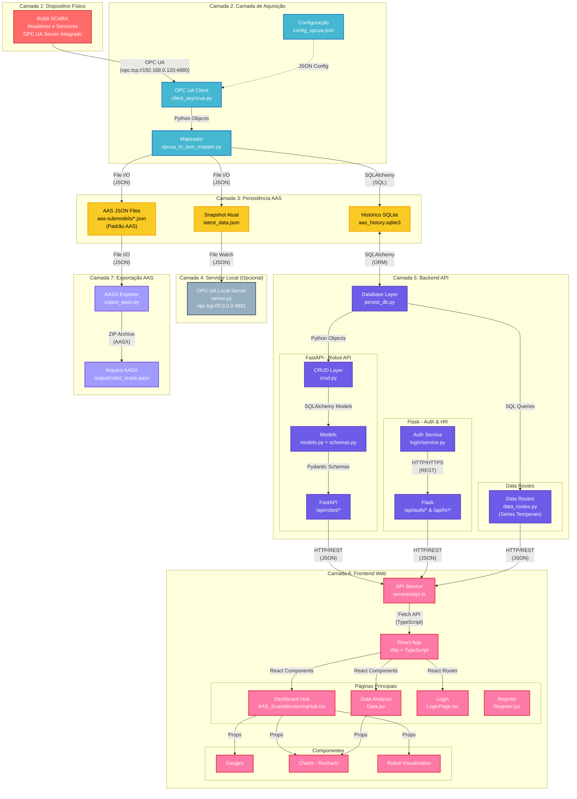
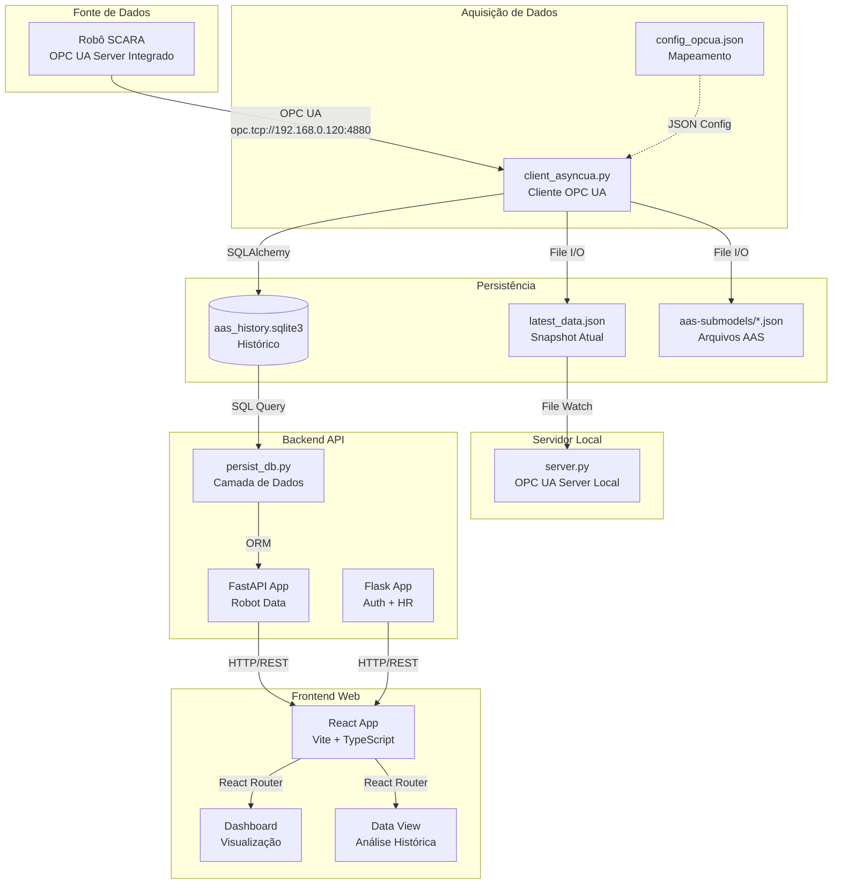
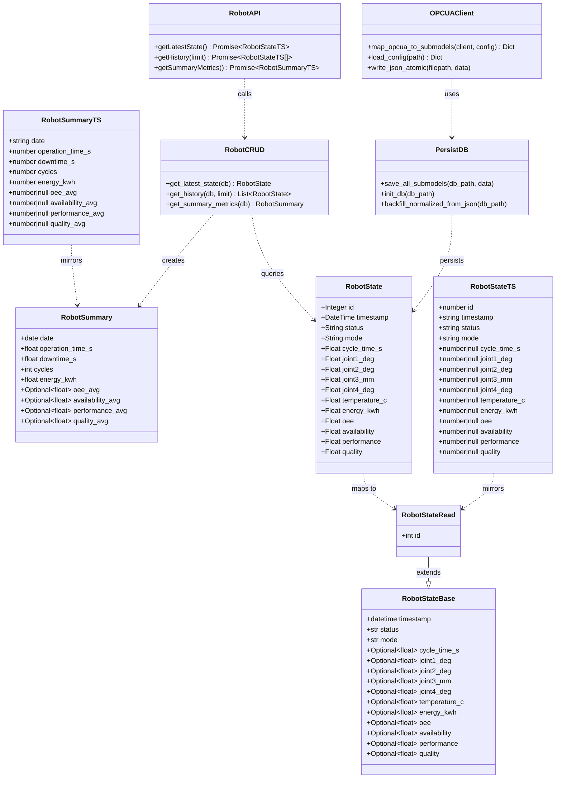
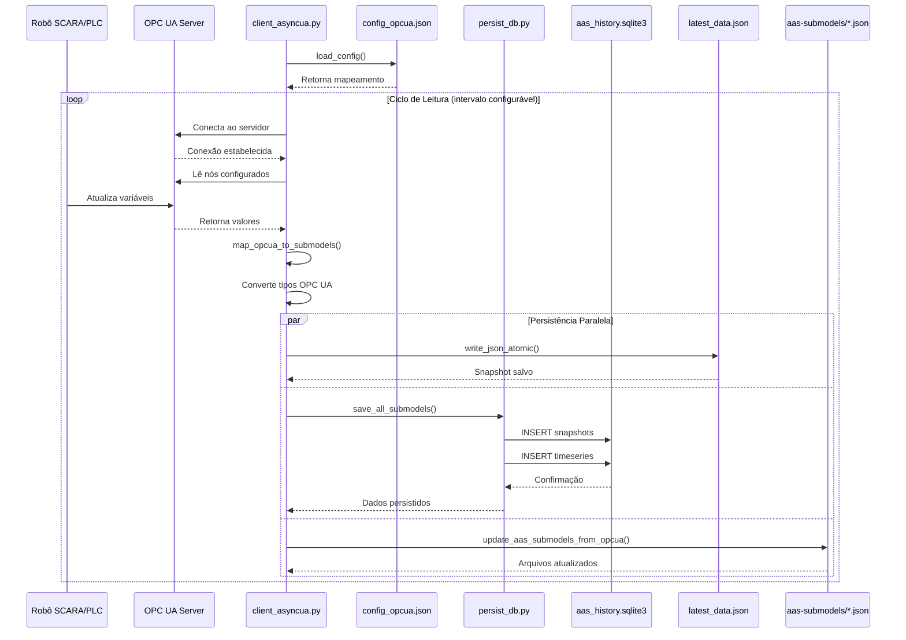
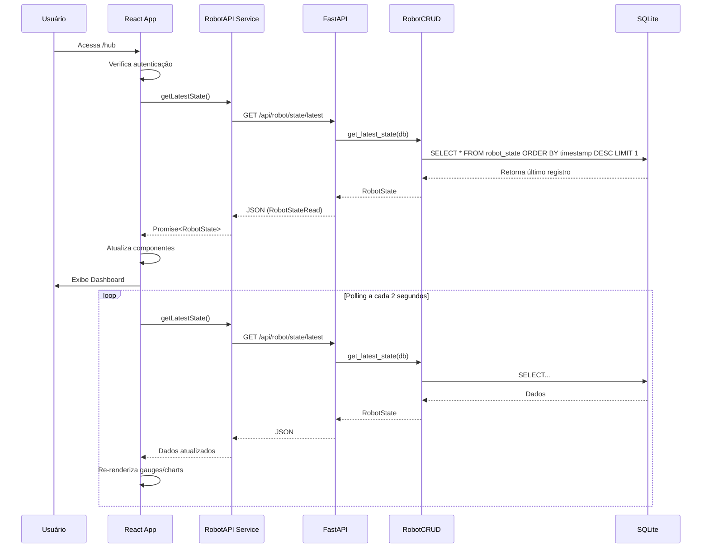
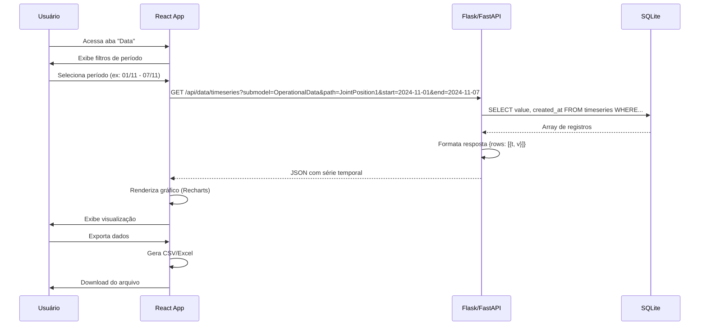
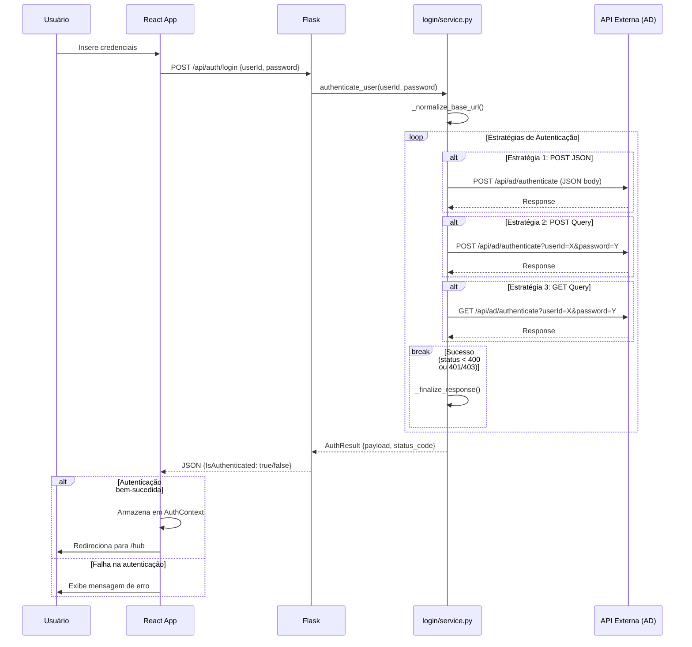
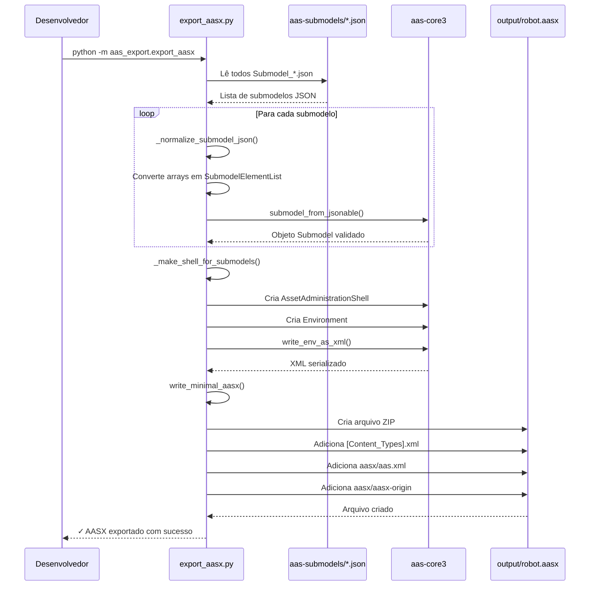

# Fluxo Completo do Sistema - AAS SCARA Robot Monitoring

## Visão Geral da Arquitetura

Este sistema monitora um robô SCARA através de OPC UA, persiste os dados seguindo o padrão Asset Administration Shell (AAS), e disponibiliza visualização web em tempo real.

## Arquitetura do Sistema



### Descrição das Camadas

**Camada 1 - Dispositivo Físico**: Robô SCARA com atuadores/sensores e servidor OPC UA integrado expondo variáveis industriais.

**Camada 2 - Aquisição**: Cliente Python assíncrono coleta dados via OPC UA e mapeia para estrutura AAS.

**Camada 3 - Persistência**: Três destinos de armazenamento (JSON AAS, snapshot atual, banco histórico SQLite).

**Camada 4 - Servidor Local**: Espelha dados via OPC UA para consumo externo sem sobrecarregar o robô.

**Camada 5 - Backend**: API híbrida (FastAPI para dados do robô, Flask para autenticação/HR).

**Camada 6 - Frontend**: SPA React com dashboard em tempo real, análise histórica e autenticação.

**Camada 7 - Exportação**: Geração de pacotes AASX padronizados para interoperabilidade.

### Protocolos de Comunicação

- **OPC UA** (opc.tcp): Comunicação industrial entre robô e cliente de aquisição
- **HTTP/REST** (JSON): APIs backend (FastAPI/Flask) para frontend
- **SQLAlchemy/SQL**: Persistência e consultas ao banco de dados SQLite
- **File I/O** (JSON): Leitura/escrita de arquivos de configuração e dados AAS
- **WebSocket** (futuro): Comunicação em tempo real planejada

## Diagrama de Fluxo



## Diagrama de Classes



## Diagramas de Sequência

### Sequência 1: Aquisição e Persistência de Dados



### Sequência 2: Monitoramento em Tempo Real (Dashboard)



### Sequência 3: Análise Histórica



### Sequência 4: Autenticação de Usuário



### Sequência 5: Exportação AASX



## Componentes Principais

### 1. Cliente OPC UA (`opcua_client/client_asyncua.py`)

**Responsabilidade**: Coletar dados do robô via OPC UA e distribuir para múltiplos destinos.

**Fluxo de Execução**:
1. Carrega configuração de `config_opcua.json`
2. Conecta ao servidor OPC UA do robô (`opc.tcp://192.168.0.120:4880`)
3. Para cada ciclo de leitura:
   - Lê valores dos nós OPC UA configurados
   - Mapeia para estrutura de submodelos AAS
   - **Salva em 3 destinos**:
     - `latest_data.json`: Snapshot mais recente
     - `data/aas_history.sqlite3`: Histórico via `persist_db.save_all_submodels()`
     - `aas-submodels/*.json`: Atualiza arquivos AAS padrão

**Modos de Operação**:
- `--once`: Executa um ciclo único
- Modo contínuo: Loop com intervalo configurável

**Arquivos Auxiliares**:
- `opcua_to_json_mapper.py`: Conversão de tipos OPC UA para JSON
- `client_read_local.py`: Cliente simplificado para debug
- `localizador.py`: Ferramenta de indexação de nós OPC UA

### 2. Persistência de Dados (`database/persist_db.py`)

**Responsabilidade**: Gerenciar armazenamento SQLite com schema otimizado.

**Schema do Banco**:

```sql
-- Snapshots JSON completos
CREATE TABLE submodel_snapshots_json (
    id INTEGER PRIMARY KEY,
    submodel_name TEXT,
    data TEXT,  -- JSON completo
    created_at TEXT
);

-- Snapshots normalizados (1 linha por elemento)
CREATE TABLE submodel_snapshots (
    id INTEGER PRIMARY KEY,
    submodel_name TEXT,
    idshort TEXT,  -- Caminho completo (ex: "OperationalData.JointPosition1")
    value_text TEXT,
    value_num REAL,
    value_bool INTEGER,
    created_at TEXT
);

-- Séries temporais (apenas valores numéricos)
CREATE TABLE timeseries (
    id INTEGER PRIMARY KEY,
    submodel_name TEXT,
    element_path TEXT,
    value REAL,
    created_at TEXT
);
```

**Funcionalidades**:
- Escrita atômica com transações
- Migração automática de dados legados
- Tratamento especial para arrays (JointPosition)

### 3. Backend API (`aas_web_template/backend`)

**Arquitetura Híbrida**: Flask + FastAPI montados via ASGI.

#### 3.1 FastAPI - Robot API (`robot_api/`)

**Endpoints**:
- `GET /api/robot/state/latest`: Estado mais recente
- `GET /api/robot/state/history?limit=50`: Histórico
- `GET /api/robot/metrics/summary`: Métricas agregadas do dia

**Camada de Dados** (`crud.py`):
- `get_latest_state()`: Última linha da tabela `robot_state`
- `get_history()`: Últimos N registros
- `get_summary_metrics()`: Calcula OEE, tempo de operação, downtime

**Modelos** (`models.py`):
```python
class RobotState(Base):
    __tablename__ = "robot_state"
    id, timestamp, status, mode
    cycle_time_s, joint1_deg, joint2_deg, joint3_mm, joint4_deg
    temperature_c, energy_kwh
    oee, availability, performance, quality
```

**Seed Data** (`seed_data.py`):
- Gera 180 registros fictícios para desenvolvimento
- Simula variação realista de métricas

#### 3.2 Flask - Auth & Integração (`login/`, `hr_proxy.py`)

**Endpoints**:
- `POST /api/auth/login`: Autenticação de usuário
- `GET /api/hr/employee?userName=X`: Proxy para sistema HR

**Estratégia de Auth** (`login/service.py`):
- Tenta múltiplos formatos de requisição (POST JSON, POST query, GET query)
- Fallback automático entre estratégias

#### 3.3 Data Routes (`data_routes.py`)

**Endpoints para análise histórica**:
- `GET /api/data/paths`: Lista todas as métricas disponíveis
- `GET /api/data/timeseries?submodel=X&path=Y`: Série temporal
- `GET /api/data/snapshots?submodel=X`: Snapshots normalizados
- `GET /api/data/stats`: Estatísticas gerais do banco
- `GET /api/data/latest`: Valores mais recentes de todas as métricas

### 4. Frontend (`aas_web_template/frontend`)

**Stack**: React 18 + Vite + TypeScript + Recharts

#### 4.1 Estrutura de Rotas (`App.tsx`)

```
/login          → LoginPage
/hub            → AAS_ScaraMonitoringHub (Dashboard principal)
/data           → Data (Análise histórica)
/register       → Register (Cadastro de planos)
```

Todas as rotas (exceto login) protegidas por `ProtectedRoute`.

#### 4.2 Dashboard (`pages/ProductionHub/AAS_ScaraMonitoringHub.tsx`)

**Componentes**:
- `StatusCard`: Status atual (Running/Idle/Alarm)
- `GaugeCard`: Medidores circulares (OEE, Availability, Performance, Quality)
- `MetricCard`: Métricas numéricas (temperatura, energia, tempo de ciclo)
- `RobotCellCard`: Visualização 3D das juntas
- `HistoryChart`: Gráfico de linha com histórico
- `EventsTable`: Tabela de eventos recentes

**Polling**: Atualiza a cada 2 segundos via `setInterval`.

#### 4.3 Data View (`pages/Data/Data.jsx`)

**Funcionalidades**:
- Filtro de período (RangeFilterInline)
- Tabela paginada com dados históricos
- Formatação brasileira de números (1.234,56)
- Export de dados

#### 4.4 Serviços (`services/api.ts`)

```typescript
getLatestState(): Promise<RobotState>
getHistory(limit): Promise<RobotState[]>
getSummaryMetrics(): Promise<RobotSummary>
```

### 5. Servidor OPC UA Local (`server_opcua_local/server.py`)

**Responsabilidade**: Espelhar dados do `latest_data.json` via OPC UA.

**Fluxo**:
1. Carrega `latest_data.json` inicial
2. Cria estrutura de nós OPC UA espelhando a hierarquia JSON
3. Inicia servidor em `opc.tcp://0.0.0.0:4881/`
4. Monitora alterações no arquivo (polling a cada 1s)
5. Atualiza valores dos nós quando arquivo muda

**Uso**: Permite que outros clientes OPC UA consumam os dados sem sobrecarregar o PLC real.

### 6. Exportação AAS (`aas_export/export_aasx.py`)

**Responsabilidade**: Gerar pacotes AASX válidos.

**Fluxo**:
1. Lê arquivos JSON de `aas-submodels/`
2. Normaliza estrutura (converte arrays em SubmodelElementList)
3. Cria Environment AAS com Shell e Submodels
4. Serializa para XML
5. Empacota em arquivo ZIP (formato AASX)

**Saída**: Arquivo `.aasx` compatível com ferramentas AAS padrão.

## Fluxos de Uso Típicos

### Fluxo 1: Monitoramento em Tempo Real

```
1. Robô executa movimento
2. PLC atualiza variáveis OPC UA
3. client_asyncua.py lê valores (ciclo a cada 0.1s)
4. Dados salvos em SQLite e latest_data.json
5. Frontend consulta /api/robot/state/latest (polling 2s)
6. Dashboard atualiza gauges e gráficos
```

### Fluxo 2: Análise Histórica

```
1. Usuário acessa aba "Data"
2. Seleciona período (ex: última semana)
3. Frontend chama /api/data/timeseries?submodel=OperationalData&path=...
4. Backend consulta tabela timeseries com filtro de data
5. Retorna array de {t: timestamp, v: value}
6. Frontend renderiza gráfico com Recharts
```

### Fluxo 3: Autenticação

```
1. Usuário insere credenciais
2. POST /api/auth/login
3. Backend tenta autenticar via API externa (AUTH_API_BASE)
4. Se sucesso, retorna token/sessão
5. Frontend armazena em contexto (AuthProvider)
6. Rotas protegidas verificam autenticação
```

### Fluxo 4: Geração de AASX

```
1. Executar script: python -m aas_export.export_aasx
2. Lê todos Submodel_*.json de aas-submodels/
3. Valida e normaliza estrutura
4. Gera Environment completo
5. Exporta para output/robot_scara.aasx
```

## Configuração e Deploy

### Variáveis de Ambiente

```bash
# OPC UA
OPCUA_SERVER_URL=opc.tcp://192.168.0.120:4880
LOG_LEVEL=INFO

# Backend
PORT=5000
AUTH_API_BASE=http://auth-server:8080
CORS_ORIGINS=http://localhost:5173,http://localhost:3000

# Frontend
VITE_API_URL=http://localhost:5000
```

### Inicialização

```bash
# 1. Backend
cd aas_web_template/backend
.venv\Scripts\activate
python app.py

# 2. Frontend
cd aas_web_template/frontend
npm install
npm run dev

# 3. Cliente OPC UA (opcional, se robô disponível)
cd opcua_client
python client_asyncua.py

# 4. Servidor OPC UA Local (opcional, para testes)
cd server_opcua_local
python server.py
```

## Tecnologias Utilizadas

**Backend**:
- Python 3.10+
- FastAPI (API moderna)
- Flask (compatibilidade legada)
- SQLAlchemy (ORM)
- asyncua (cliente/servidor OPC UA)
- aas-core3 (validação AAS)

**Frontend**:
- React 18
- TypeScript
- Vite (build tool)
- Recharts (visualização)
- React Router (navegação)

**Banco de Dados**:
- SQLite (desenvolvimento/produção leve)

**Protocolos**:
- OPC UA (comunicação industrial)
- HTTP/REST (API web)
- WebSocket (futuro: real-time)
