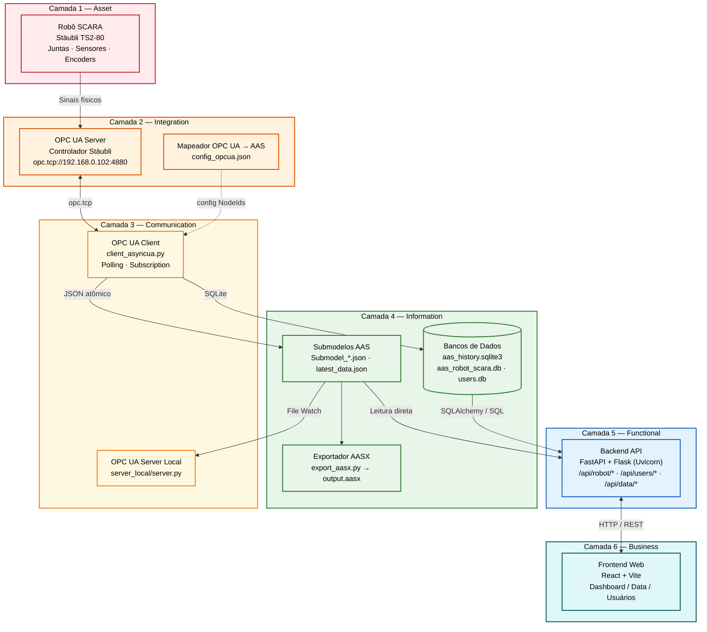
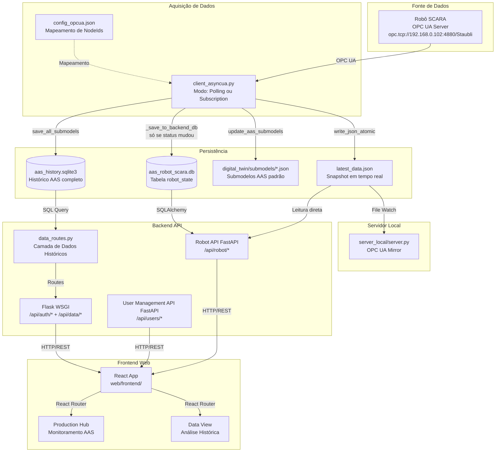
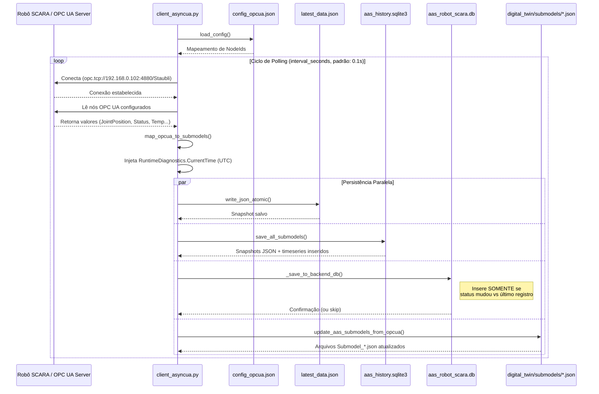
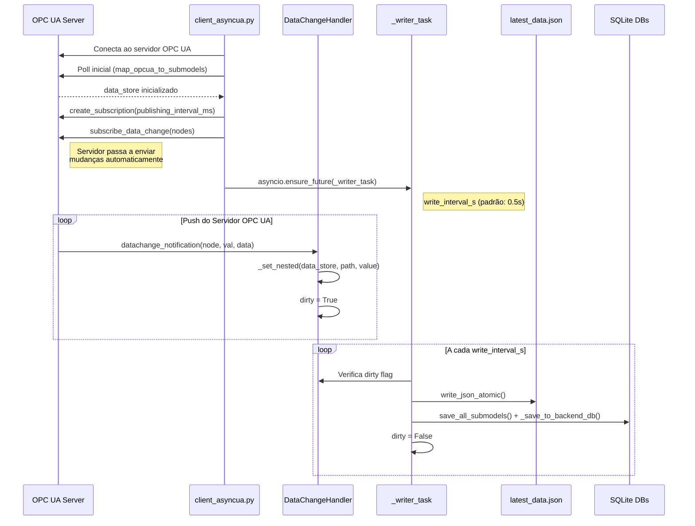
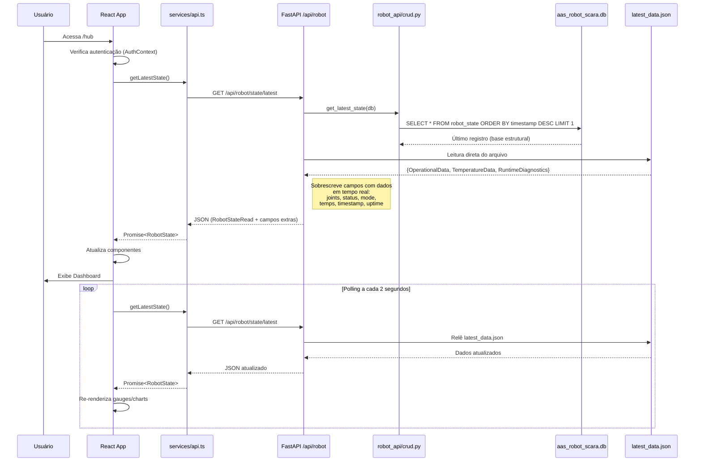
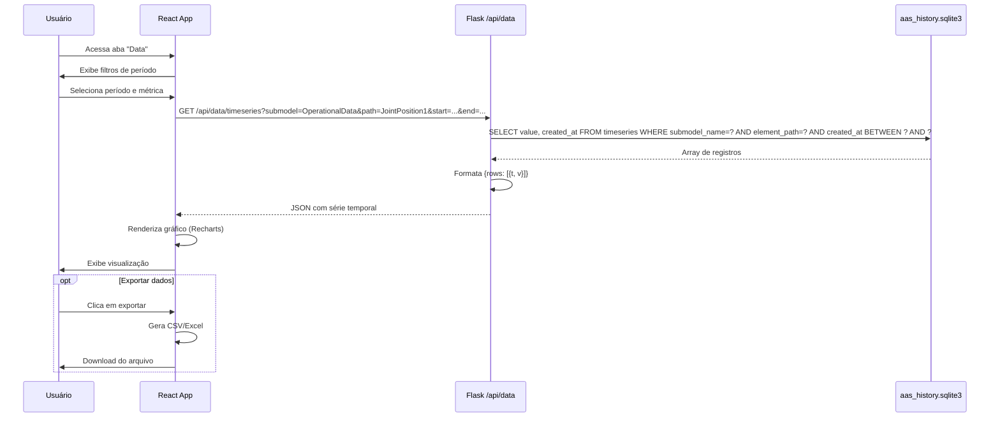
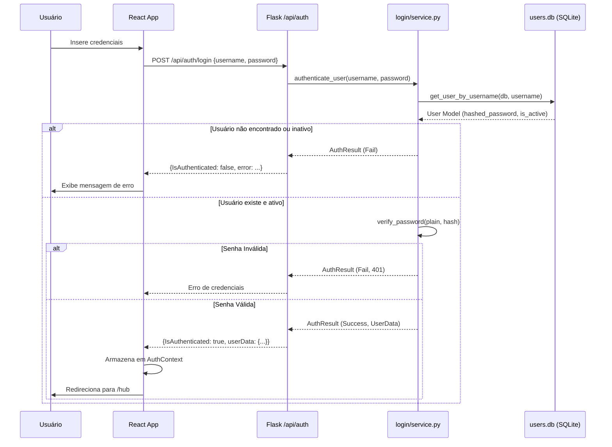
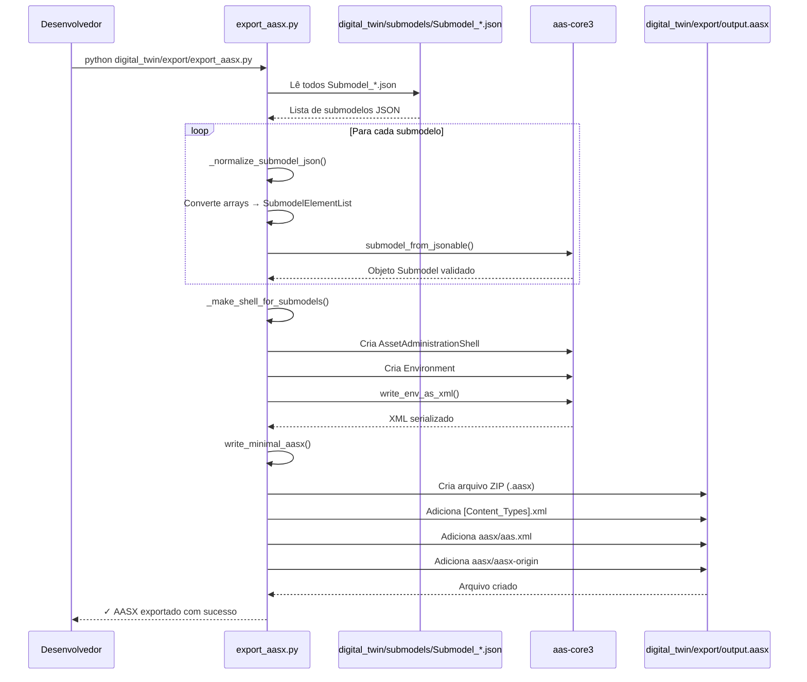

# Fluxo Completo do Sistema - AAS SCARA Robot Monitoring

### Visão Geral da Arquitetura

Este sistema monitora um robô SCARA via OPC UA, persiste dados no padrão **AAS (Asset Administration Shell)** e disponibiliza visualização web em tempo real. A arquitetura segue as 6 camadas do **RAMI 4.0** (Reference Architecture Model Industrie 4.0).

## Arquitetura do Sistema — Camadas RAMI 4.0



### Camadas RAMI 4.0 — Resumo

| Camada | Descrição | Componentes |
|--------|-----------|-------------|
| **6 — Business** | Interface com o usuário final | Dashboard React, páginas de dados e gestão de usuários |
| **5 — Functional** | Lógica de negócio e serviços | FastAPI (robot + users), Flask (auth + histórico), cálculo de OEE |
| **4 — Information** | Armazenamento e semântica AAS | Submodelos JSON, `latest_data.json`, SQLite (histórico, robô, usuários), exportador AASX |
| **3 — Communication** | Protocolos de rede | `client_asyncua.py` (polling/subscription), servidor OPC UA espelho |
| **2 — Integration** | Ponte físico-digital | OPC UA Server do controlador, mapeador NodeIds → AAS |
| **1 — Asset** | Ativo físico real | Robô Stäubli TX2-60, juntas J1–J4, sensores de temperatura e encoders |

---

## Diagrama de Fluxo



---

## Diagrama de Classes

```mermaid
classDiagram
    %% Acquisition Layer
    class OPCUAClient {
        +SERVER_URL: str
        +CONFIG_FILE: str
        +OUTPUT_FILE: str
        +DB_PATH: str
        +BACKEND_DB_PATH: str
        +load_config(path) Dict
        +map_opcua_to_submodels(client, config) Dict
        +update_aas_submodels_from_opcua(client, folder) List
        +write_json_atomic(filepath, data)
        +run_subscription(client, config)
        -_run_once(client, config)
        -_save_to_backend_db(data, timestamp_iso)
    }

    class DataChangeHandler {
        -_node_map: Dict[str, list]
        +data_store: dict
        +dirty: bool
        +datachange_notification(node, val, data)
        +status_change_notification(status)
    }

    class WriterTask {
        +write_interval: float
        +run() async
    }

    %% Backend Models - Robot
    class RobotState {
        +Integer id
        +DateTime timestamp
        +String status
        +String mode
        +Float cycle_time_s
        +Float joint1_deg
        +Float joint2_deg
        +Float joint3_mm
        +Float joint4_deg
        +Float temperature_c
        +Float energy_kwh
        +Float oee
        +Float availability
        +Float performance
        +Float quality
        +Float motorProbe1_temp
        +Float motorProbe2_temp
        +Float motorProbe3_temp
        +Float motorProbe4_temp
        +Float uptime_s
    }

    class RobotCRUD {
        +get_latest_state(db) RobotState
        +get_history(db, limit) List~RobotState~
        +get_summary_metrics(db) RobotSummary
    }

    class RobotAPI {
        +GET /state/latest → RobotStateRead
        +GET /state/history → List~RobotStateRead~
        +GET /metrics/summary → RobotSummary
    }

    %% Backend Models - Users
    class UserModel {
        +Integer id
        +String username
        +String email
        +String hashed_password
        +Boolean is_active
    }

    class UserCRUD {
        +create_user(db, data) UserModel
        +get_user_by_id(db, id) UserModel
        +list_users(db, skip, limit) List
        +update_user(db, id, data) UserModel
        +count_users(db) int
    }

    class UserManagementAPI {
        +POST /register → UserRead
        +GET /users → UserList
        +GET /users/{id} → UserRead
        +PUT /users/{id} → UserRead
    }

    %% Backend Auth
    class AuthService {
        +authenticate_user(username, password) AuthResult
        +verify_password(plain, hashed) bool
    }

    %% Persistence
    class PersistDB {
        +save_all_submodels(db_path, data)
        +init_db(db_path)
        +backfill_normalized_from_json(db_path)
    }

    %% Relationships
    OPCUAClient --> DataChangeHandler : creates
    DataChangeHandler --> WriterTask : signals dirty
    OPCUAClient --> PersistDB : uses
    RobotAPI --> RobotCRUD : calls
    RobotCRUD --> RobotState : queries
    UserManagementAPI --> UserCRUD : calls
    UserCRUD --> UserModel : manages
    RobotAPI ..> OPCUAClient : reads latest_data.json
```

---

## Diagramas de Sequência

### Sequência 1: Aquisição — Modo Polling



### Sequência 2: Aquisição — Modo Subscription (Push-based)



### Sequência 3: Monitoramento em Tempo Real (Dashboard)



### Sequência 4: Análise Histórica



### Sequência 5: Autenticação de Usuário



### Sequência 6: Exportação AASX



---

## Componentes Principais

### 1. Cliente OPC UA (`acquisition/client/client_asyncua.py`)

**Responsabilidade**: Coletar dados do robô via OPC UA e distribuir para múltiplos destinos.

**Dois modos de operação**:

| Flag/Config | Modo | Descrição |
|-------------|------|-----------|
| `--once` | Ciclo único | Um poll, salva e encerra |
| `--subscription` / `mode: subscription` | Subscription (push) | Recebe notificações do servidor; `DataChangeHandler` atualiza `data_store` em memória; `_writer_task` persiste a cada `write_interval_s` |
| Padrão (polling) | Loop contínuo | Repete `_run_once()` a cada `interval_seconds` (padrão: 0.1s) |

**Estratégia de reconexão**: Backoff automático com delays `[5, 10, 30, 60]` segundos.

**`_save_to_backend_db`**: Insere em `aas_robot_scara.db` **somente se** o `status` do robô mudou em relação ao último registro (evita escrita redundante).

**Configuração (precedência)**:
1. Argumentos CLI (`--once`, `--interval`, `--subscription`)
2. Variáveis de ambiente (`OPCUA_SERVER_URL`, `OPCUA_CLIENT_ENABLED`, `OPCUA_CLIENT_INTERVAL`)
3. `config_opcua.json` (bloco `_client`)

**Arquivos auxiliares**:
- `opcua_to_json_mapper.py`: Conversão de tipos OPC UA para JSON
- `config_opcua.json`: Mapeamento NodeId → estrutura AAS (com suporte a `policy`, `manual`, `transform`)
- `client_read_local.py`: Cliente simplificado para debug
- `localizador.py`: Ferramenta de indexação de nós OPC UA

---

### 2. Persistência — AAS History (`persistence/db/persist_db.py`)

**Responsabilidade**: Gerenciar armazenamento SQLite com schema AAS otimizado.

**Schema do banco** (`aas_history.sqlite3`):

```sql
-- Snapshots JSON completos por submodelo
CREATE TABLE submodel_snapshots_json (
    id INTEGER PRIMARY KEY,
    submodel_name TEXT,
    data TEXT,          -- JSON completo do submodelo
    created_at TEXT
);

-- Snapshots normalizados (1 linha por elemento)
CREATE TABLE submodel_snapshots (
    id INTEGER PRIMARY KEY,
    submodel_name TEXT,
    idshort TEXT,       -- Caminho completo, ex: "OperationalData.JointPosition1"
    value_text TEXT,
    value_num REAL,
    value_bool INTEGER,
    created_at TEXT
);

-- Séries temporais (apenas valores numéricos)
CREATE TABLE timeseries (
    id INTEGER PRIMARY KEY,
    submodel_name TEXT,
    element_path TEXT,
    value REAL,
    created_at TEXT
);
```

---

### 3. Backend API (`web/backend/`)

**Ponto de entrada**: `app.py` — servidor ASGI único (Uvicorn) com três sub-aplicações montadas.

#### 3.1 Robot API — FastAPI (`robot_api/`)

Montada em `/api/robot`.

**Estratégia de dados em `/state/latest`**:
1. Busca o último `robot_state` do banco (`aas_robot_scara.db`) como base estrutural
2. **Sobrescreve em memória** com dados de `latest_data.json` (leitura direta do arquivo) para garantir tempo real:
   - Joints (J1, J2, J3 convertido para mm, J4)
   - Status, Mode
   - Timestamp (`RuntimeDiagnostics.CurrentTime`)
   - Uptime calculado (`CurrentTime - StartTime`)
   - Temperaturas por eixo (`motorProbe1_temp` a `motorProbe4_temp`)
   - Temperatura global (`IWtemperature`)

**Endpoints**:
| Endpoint | Descrição |
|----------|-----------|
| `GET /api/robot/health` | Healthcheck |
| `GET /api/robot/state/latest` | Estado atual com dados em tempo real |
| `GET /api/robot/state/history?limit=50` | Histórico de até 500 registros |
| `GET /api/robot/metrics/summary` | OEE, tempo de operação, downtime do dia |

#### 3.2 User Management API — FastAPI (`user_management/`)

Montada em `/api/users`.

**Endpoints**:
| Endpoint | Descrição |
|----------|-----------|
| `POST /api/users/register` | Cadastra novo usuário |
| `GET /api/users/users` | Lista todos os usuários |
| `GET /api/users/users/{id}` | Busca usuário por ID |
| `PUT /api/users/users/{id}` | Atualiza dados do usuário |

#### 3.3 Flask — Auth & Dados (`login/`, `data_routes.py`)

Montado na raiz via `WSGIMiddleware`.

**Auth** (`/api/auth/login`):
- `login/service.py`: tenta múltiplos formatos de requisição (POST JSON, POST query, GET query)
- Valida senha via hash no `users.db`

**Dados históricos** (`/api/data/*`):
| Endpoint | Descrição |
|----------|-----------|
| `GET /api/data/paths` | Lista todas as métricas disponíveis |
| `GET /api/data/timeseries?submodel=X&path=Y&start=&end=` | Série temporal filtrada |
| `GET /api/data/snapshots?submodel=X` | Snapshots normalizados |
| `GET /api/data/stats` | Estatísticas gerais do banco |
| `GET /api/data/latest` | Valores mais recentes de todas as métricas |

---

### 4. Frontend (`web/frontend/`)

**Stack**: React 18 + Vite + TypeScript + Recharts

#### 4.1 Estrutura de Rotas (`App.tsx`)

```
/                → LandingPage (página inicial)
/login           → LoginPage
/hub             → AAS_ScaraMonitoringHub (Dashboard principal)
/data            → Data (Análise histórica)
/register        → Register (Cadastro de planos/usuários)
```

Todas as rotas (exceto `/` e `/login`) protegidas por `ProtectedRoute`.

#### 4.2 Dashboard (`pages/ProductionHub/AAS_ScaraMonitoringHub.tsx`)

- `StatusCard`: Status atual (`Running` / `Idle` / `Alarm` / `Unknown`)
- `GaugeCard`: Medidores circulares (OEE, Availability, Performance, Quality)
- `MetricCard`: Temperatura global, energia, tempo de ciclo, uptime
- `RobotCellCard`: Visualização 3D das juntas do SCARA
- `HistoryChart`: Gráfico de linha com histórico
- `EventsTable`: Tabela de eventos recentes (últimos estados)
- Temperatura por eixo: `motorProbe1_temp` a `motorProbe4_temp`

**Polling**: Atualiza a cada 2 segundos via `setInterval`.

#### 4.3 Serviços (`services/`)

```typescript
// api.ts — Robot data
getLatestState(): Promise<RobotState>
getHistory(limit): Promise<RobotState[]>
getSummaryMetrics(): Promise<RobotSummary>

// userApi.ts — User management
registerUser(data): Promise<UserRead>
listUsers(): Promise<UserList>
getUserById(id): Promise<UserRead>
updateUser(id, data): Promise<UserRead>
```

---

### 5. Servidor OPC UA Local (`acquisition/server_local/server.py`)

**Responsabilidade**: Espelhar dados de `latest_data.json` via OPC UA para consumo externo.

**Fluxo**:
1. Carrega `latest_data.json` inicial
2. Cria estrutura de nós OPC UA espelhando a hierarquia JSON
3. Inicia servidor em `opc.tcp://0.0.0.0:4881/`
4. Monitora alterações no arquivo (polling a cada 1s)
5. Atualiza valores dos nós quando arquivo muda

**Uso**: Permite que outros clientes OPC UA consumam dados sem sobrecarregar o PLC real.

---

### 6. Digital Twin — Submodelos e Exportação AAS

**Submodelos** (`digital_twin/submodels/`): Arquivos `Submodel_*.json` no formato AAS, atualizados diretamente pelo cliente OPC UA via qualifiers `opcua.nodeid`.

**Exportação AASX** (`digital_twin/export/export_aasx.py`):
1. Lê arquivos JSON de `digital_twin/submodels/`
2. Normaliza estrutura (converte arrays para `SubmodelElementList`)
3. Cria `Environment` AAS com `AssetAdministrationShell` e `Submodel`s
4. Serializa para XML via `aas-core3`
5. Empacota como ZIP no formato `.aasx`

---

## Fluxos de Uso Típicos

### Fluxo 1: Monitoramento em Tempo Real

```
1. Robô executa movimento → PLC atualiza variáveis OPC UA
2. client_asyncua.py recebe notificação (subscription) ou lê no polling (0.1s)
3. Dados salvos em latest_data.json + SQLite (se mudança de status)
4. Frontend consulta GET /api/robot/state/latest (polling 2s)
5. Backend lê latest_data.json e sobrescreve dados do banco
6. Dashboard atualiza gauges, temperatura e posição das juntas
```

### Fluxo 2: Análise Histórica

```
1. Usuário acessa aba "Data"
2. Seleciona período e métrica (ex: JointPosition1 da última semana)
3. Frontend chama GET /api/data/timeseries?submodel=OperationalData&path=JointPosition1&start=...&end=...
4. Backend (Flask) consulta tabela timeseries com filtro de data
5. Retorna array de {t: timestamp, v: value}
6. Frontend renderiza gráfico com Recharts
```

### Fluxo 3: Autenticação

```
1. Usuário insere credenciais em /login
2. POST /api/auth/login {username, password}
3. Flask valida credenciais no users.db (hash bcrypt)
4. Se sucesso → {IsAuthenticated: true, userData: {...}}
5. Frontend armazena em AuthContext (localStorage)
6. Rotas protegidas verificam AuthContext antes de renderizar
```

### Fluxo 4: Cadastro de Usuário

```
1. Usuário acessa /register
2. POST /api/users/register {username, email, password}
3. FastAPI User Management cria hash, persiste em users.db
4. Retorna UserRead com dados do novo usuário
```

### Fluxo 5: Geração de AASX

```
1. Executar: python digital_twin/export/export_aasx.py
2. Lê todos Submodel_*.json de digital_twin/submodels/
3. Valida e normaliza estrutura para AAS
4. Gera Environment completo com Shell e Submodels
5. Serializa para XML e empacota em digital_twin/export/output.aasx
```

---

## Configuração e Deploy

### Variáveis de Ambiente

```bash
# OPC UA Client
OPCUA_SERVER_URL=opc.tcp://192.168.0.102:4880/Staubli
OPCUA_CLIENT_ENABLED=true         # true|false
OPCUA_CLIENT_INTERVAL=0.1         # segundos (modo polling)
LOG_LEVEL=INFO

# Backend
PORT=5000
CORS_ORIGINS=http://localhost:5173,http://localhost:3000
DEBUG=false

# Frontend
VITE_API_URL=http://localhost:5000
```

### Inicialização (start.ps1)

```powershell
# O script start.ps1 inicializa automaticamente:
# 1. Backend (Uvicorn com FastAPI + Flask)
# 2. Frontend (Vite dev server)
# 3. Cliente OPC UA (opcional, se robô disponível)
.\start.ps1
```

### Inicialização Manual

```bash
# 1. Backend
cd web/backend
.venv\Scripts\activate
python app.py          # Uvicorn em http://0.0.0.0:5000

# 2. Frontend
cd web/frontend
npm install
npm run dev            # Vite em http://localhost:5173

# 3. Cliente OPC UA (modo subscription — recomendado)
cd <raiz do projeto>
python acquisition/client/client_asyncua.py --subscription

# 3. Cliente OPC UA (modo polling — alternativo)
python acquisition/client/client_asyncua.py

# 4. Servidor OPC UA Local (espelho, opcional)
cd acquisition/server_local
python server.py
```

---

## Tecnologias Utilizadas

**Backend**:
- Python 3.10+
- FastAPI (robot API + user management)
- Flask / Flask-CORS (auth + dados históricos)
- Uvicorn (servidor ASGI)
- SQLAlchemy (ORM para `aas_robot_scara.db` e `users.db`)
- asyncua (cliente/servidor OPC UA)
- aas-core3 (validação e serialização AAS)

**Frontend**:
- React 18
- TypeScript
- Vite (build tool)
- Recharts (visualização de dados)
- React Router (navegação SPA)

**Banco de Dados**:
- SQLite — três instâncias:
  - `persistence/storage/aas_history.sqlite3`: histórico AAS completo
  - `web/backend/robot_api/aas_robot_scara.db`: estado atual do robô para API
  - `web/backend/user_management/users.db`: gerenciamento de usuários

**Protocolos**:
- OPC UA (`asyncua`) — comunicação industrial bidirecional
- HTTP/REST (JSON) — API web
- File I/O atômica — comunicação entre cliente e API via `latest_data.json`
